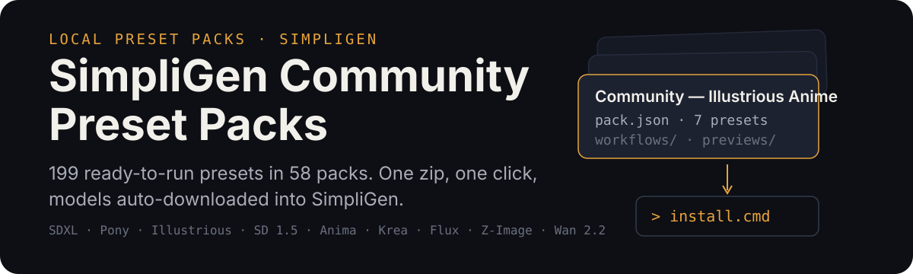
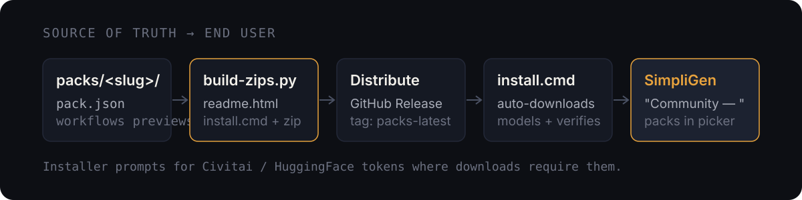

<p align="center">
  
</p>

Custom local preset packs for [SimpliGen](https://www.simpligen.io/), covering image models across SDXL, Pony, Illustrious, SD 1.5, Anima, Krea 2, Flux (1 & 2), Z-Image, SeFi and Iris-3B — plus video: MiniMax H3 packs (text/image/reference-to-video with synchronized audio), LTX 2.5 image-to-video and lip-sync packs, a Wan 2.2 image-to-video pack, and music: YuE2 and MiniMax Music 3 songs, plus YuE2 cover songs, with album art.

**Getting a pack takes three steps:** download the pack zip from the [Releases page](https://github.com/michaeldune/simpligen-presets/releases/tag/packs-latest), unzip it, and run `install.cmd`. The installer downloads the models for you, verifies them, and the pack appears in SimpliGen's preset picker under `Community — `.

> This repo is the source of truth the zips are built from — and now the distribution point too. The `packs-latest` release is rolling: its assets get replaced each time `build-zips.py` runs, so the same link always has the current set. End users never need to clone it.

<p align="center">
  
</p>

**Image packs**

| Pack | Presets | Architecture | Notes |
|---|---|---|---|
| SDXL Realism | 5 | SDXL 1.0 | Photoreal, baked VAE, no CLIP skip |
| SDXL Art & Anime | 5 | SDXL 1.0 | Stylized/anime |
| Pony Anime | 4 | Pony (SDXL) | CLIP Skip 2, score tags |
| Pony Realistic | 3 | Pony (SDXL) | Photoreal/semi-real |
| Illustrious Realism | 6 | Illustrious (SDXL) | Photoreal & semi-real |
| Illustrious Anime | 11 | Illustrious (SDXL) | Anime, incl. V-Pred models and (since 1.3.0) WAI Illustrious SDXL v17. Since 1.4.0, two community-requested merges that stay **close to their parents**: MoonMix XL v1.0 (soft, pale colouring; close to WAI v17) and ClearColor Air XL v1.0 (light, clean colour; close to Nova Anime) |
| SD 1.5 Anime | 3 | SD 1.5 | External kl-f8-anime2 VAE, 512-base |
| DucHaiten | 9 | SD 1.5 ×5, SDXL ×1, NoobAI ×2, Pony ×1 | DucHaiten's checkpoint family: GoldenLife, Retro, Real3D-NSFW, StyleLikeMe and ThiccBoi on SD 1.5 (512-base, CLIP Skip 2); GoldenAge on SDXL; NoobAI-Cinematic plain and Snapvu hires; GameArt UnrealEngine on Pony. ThiccBoi also lives in SD 1.5 Anime, same checkpoint |
| Reij's Merges | 6 | Illustrious (SDXL) | reijlita merge family |
| Anima Anime | 20 | Anima (Cosmos) | UNet + Qwen encoder + Qwen-Image VAE. Since 1.3.0, VXP Anima Turbo V1 (14 steps, about 12 s). Since 1.4.0, six more: RDBT v2.3 (16 steps, about 6 s, the newer RDBT), Element 7 Nexus Prism IV (glossy, high contrast), One Obsession v4.0 (good pictures from plain prompts), Diving v8.0 (flat cel shading, about 11 s), Anima-2.9B v1 (40-layer Anima, characters up to July 2026, needs detailed prompts) and Nova Orange AM v4.0 (bright and clean, on the 2.9B base). Since 1.5.0, seven more: the official Anima Turbo v1.1 (10 steps, about 6 s), Riaku Lab v1.0 (painterly light; give it long prompts), Pearly Unknown v1.0 (muted, moody, detailed backgrounds), Pie Models Cream v2 (soft, glowing 2.5D), and three on the 2.9B base: Delta Mix v7.0 Flat (soft, cool-toned 2.5D), KodoraAN v5.0 (bright and glossy) and CC-Dream Island Mature (write "mature woman" rather than "1girl"). The 1.5.0 cards leave out the Anima system prompt, which some models print into the picture; 1.5.1 removes it from four shipped cards that did (Anima base, VXP Turbo, Diving, Nova Orange). Since 1.6.0, Unholy Desire Mix Dark Serenity v3.0 (community request): crisp, polished anime that keeps busy prompts in order, about 15 s |
| Anima Realism | 3 | Anima (Cosmos) | Same stack, photoreal |
| Krea 2 Identity Edit | 2 | Krea 2 Turbo + Identity Edit LoRA v1.2 | **Image editing.** Hand it a photo and an instruction in plain English. Identity Edit changes one thing and leaves the rest alone; Identity Lock holds a face while you re-stage a character sheet into a new scene, transfer a face between two images, or do virtual try-on. Takes one or two reference images — image 1 is the scene, image 2 is the subject. Shares the Krea 2 checkpoint, encoder and VAE with the Krea 2 pack, so the only new download is a 1.83 GB LoRA. No masked inpainting: SimpliGen presets cannot pass a mask |
| Outfit Spec Sheet | 2 | Qwen Image Edit 2511 + Lightning 4-step; Qwen-Image 2.1 (two-pass) | **Image editing, fixed brief.** One photo of an outfit in, one fashion-house specification board out. **Original card** (Apache-2.0): the garments and accessories lifted onto a mannequin against warm ivory, three close-up detail crops, deliberately no text; same weights as SimpliGen's own Image Edit pack, so nothing new downloads if that is installed. **Qwen 2.1 card** (added in 1.1.0): two passes in one job, first the outfit is lifted off the person as a ghost-mannequin shot, then the board is built around it with the heading OUTFIT SPECIFICATION, three detail crops and four colour swatches taken from the real colours. It removes the person every time and keeps hats, bags and shoes the original drops, but it is not reliable on every try: the whole outfit survived on 6 of 9 test boards, so re-roll the seed when a coat or a shirt goes missing. About a minute per board; same weights as the Qwen Image 2.1 pack. **Qwen Research Licence, non-commercial use only** - for commercial work use the original card. Since 1.1.0 the pack needs SimpliGen engine 0.37.0. The prompt box is optional extra notes |
| Qwen Image 2.1 | 16 | Qwen-Image 2.1 7B (INT8) + Qwen3-VL 8B encoder | **One model, sixteen cards:** text to image (renders legible signs and captions), editing with 1–4 reference images in plain English, a Cutout card that removes the background and saves a real transparent PNG at the source size, and (since 1.1.0) a **Character Sheet** card: one picture of a person in, a sheet out with a large head, a headless full-body front view, a back view and two mirrored profiles on white; an optional second picture dresses the person in that outfit. The sheet layout comes from the Portrait2CharRef LoRA by b675051045971 (328 MB, built in); set the aspect ratio to 3:2. Since 1.2.0, two **4MP** cards: text to image at the model's full ~4-megapixel size (about 1.5 min on 12 GB), and **Enhance to 4MP**, which adds real detail to any picture while keeping faces and lettering (Detail Enhancer LoRA by Elusarca, 76 MB, built in). Since 1.3.0, **Edit 4MP**: the Edit card with 1-4 pictures and 4MP output (about 2 min with one picture, under 4 with four on 12 GB). Since 1.5.0, **Fast Drafts**: text to image in 5 steps with Viggle's turbo LoRA (1.36 GB, built in), about 11 s a picture in the app instead of about 40; small lettering garbles more often, so move keepers to the main card. Since 1.6.0, **Fast Edit**: edits in 8 steps with PrunaAI's distill LoRA (336 MB), about 20 s for a one-picture edit instead of about 80, best with one picture. Since 1.7.0, **Head Swap** (one person's face and hair into another picture) and **Outfit Swap** (a person dressed in the clothes and shoes from another picture), about 1 minute each. Since 1.8.0, **Edit (Steady Frame)**: the Edit card plus ausboss's Consistency LoRA (159 MB), so the edit stays on the original's frame; measured on 14 edits, watercolor restyles drifted 5 px instead of 44 px (median) and local edits 0.1 px instead of up to 7 px, about a third slower with one picture. About 20 s per image on a 4070 Ti, under a minute for a two-reference edit. Since 1.9.0, **Fast (HDR)**: Fast Drafts decoded through Felldude's HDR VAE (1.35 GB) for punchier colour and crisper detail on photo-style prompts; a look, not an upgrade: whites clip sooner and it is a few seconds slower. Since 1.10.0, **Turbo**: Qwen's official 8-step Turbo as a LoRA (0.9 GB, Comfy-Org's extraction), about 15 s a picture like Fast Drafts but far better at small lettering inside a scene (a street-cart sign correct on 3 of 3 seeds against 0 of 3). Since 1.11.0, **Turbo 4MP**: the Turbo card at the full ~4-megapixel size, about 40 s a picture on 12 GB against about 1.5 min for the 4MP card, with small faces and skin on a par with it; no extra download. Since 1.12.0, **Pose Studio**: picture 1 a full-body photo (or a saved character), picture 2 a 3D doll in the pose you want, and the person is moved into the pose keeping face, clothes and background (MiuProject's VNCCS Pose Studio LoRA, MIT, 0.16 GB); framed dolls to download in the free [doll gallery](https://michaeldune.github.io/simpligen-pose-gallery/), every result on the floor in the doll's pose in our tests (8/8 in the app, 32/32 in ComfyUI). **Needs SimpliGen engine 0.37.0 or newer.** 17.3 GB download (18.7 GB with Fast Drafts). **Licence: Qwen Research Licence, non-commercial use only** |
| Qwen Image 2.1 Noct Q | 1 | Noct Q V4 (INT8), built on Qwen-Image 2.1 + Qwen3-VL 8B encoder | **NSFW. Qwen-Image 2.1 with the censorship taken out.** Noctaluna's Noct Q V4: nudes and explicit scenes render without a LoRA, and it keeps Qwen's long-prompt following and readable lettering. One text-to-image card at the author's settings (25 steps, euler / simple, CFG 3 with the author's negative prompt built in), about 50 s a picture on a 12 GB card at about 1.5 megapixels; 2:3 (1024x1536) is the recommended shape. Write prompts as full-sentence captions with an adult age stated. Shares the encoder and VAE with the Qwen Image 2.1 pack, so it adds only the 7.3 GB model. **Needs SimpliGen engine 0.37.0 or newer. Licence: Qwen Research Licence, non-commercial use only** |
| Krea 2 | 11 | Krea 2 DiT | Uncensored mixes, 8–10 step distilled. Renders at native ~2 MP (1408×1408 and equivalents) plus an Upscale slider with a gated 4-step refine pass; 2 MP costs ~5 s more than 1 MP on a 4070 Ti. Includes two free GGUF builds of Dark Beast (Q8 and Q4, about 40 s each on 12 GB), since its FP8 file is now paid on Civitai. Since 1.8.0: two cards from VXP's experimental Krea 2 beta series, Beta 4 (anime and illustration) and Beta 3 (the same look on photographs), both with a dark, backlit, high-contrast grade none of the other cards give. Since 1.9.0: DaSiWa Krea2 DarkDesire V3 (Darksidewalker, community request), **close to stock Krea 2**: richer painted skies, bolder anime lines, deeper reds; about 22 s |
| Krea 2 Art & Styles | 9 | Krea 2 DiT | **Four Krea 2 checkpoints that do not look like Krea 2**, picked from six tested side by side against stock Krea 2 Turbo. Equinox (crisp, idealised semi-real characters), Fascium KREA ART (99 painterly artist styles, turns everything into paint; SFW by design), Fwaun Tune (flat-colour, lineless semi-chibi) and Wulver (anthro and kemono characters, `@artist` tokens). Since 1.1.0, four community-requested anime checkpoints: Krea2-Anime v2.0 (the most distinct: clean, flat anime with thin lines; wants long prompts), CocoaMix v0.03 (soft, cute faces with bright eye highlights), and two that stay **close to stock Krea 2**, See-Krea2 Genesis V2 (warmer faces, elf and kitsune triggers) and Krea 2 Full v1.0 Anime (softer faces, the fastest). Since 1.2.0, Krea-2-Nippon_clear, also **close to stock** and also by request: cleaner, brighter cel-anime faces and deeper blues on Japanese subjects; 15.9 GB, non-commercial use only. Native ~2 MP plus the Upscale slider; each card costs only its 13–16 GB checkpoint on top of the shared Krea 2 encoder and VAE. For photography use Krea 2 or Krea 2 Finetunes |
| Krea 2 Finetunes | 6 | Krea 2 DiT | Trained checkpoints, not merges: Muse v3.5 Extended (clean SFW editorial, real 8–20 step / CFG 1–3 range, ships 12 steps / CFG 1.5), FinalCut Massive Update (matte skin instead of Krea gloss, native up to 2432×1920, NSFW-capable), Binyuan Portrait v3.2 (East Asian portrait realism, trained on ~1,000 unedited photos), Kreamania V8 (Adel_AI's refinement of Krea 2: volumetric light, matte skin, NSFW intact, 10 steps / CFG 1) and Kroma v0.3 Turbo (lodestones' fine-tune on the Chroma dataset, more artistic range, uncensored). Since 1.4.0, CyberRealistic v4.0 (Cyberdelia): photographic by default, natural skin and believable light from plain sentences, about 23 s a picture. Shares the Krea 2 pack's encoder and VAE. Renders at native ~2 MP (1408×1408 and equivalents) plus an Upscale slider with a 4-step refine pass, matching the official Krea 2 Turbo preset; 2 MP costs ~5 s more than 1 MP on a 4070 Ti |
| Krea Flux | 1 | Flux.1 Krea (GGUF) | CSG Foundation, low-VRAM |
| Flux 2 Klein | 2 | Flux 2 | 9B + 4B, 4-step distilled — **non-commercial license (BFL)**. A third preset, MiracleIn NSFW, was retired 2026-08-30 when Civitai's author put paid access on every version of that checkpoint; it is kept in `packs/flux2-klein/retired/` for manual install |
| Iris-3B | 2 | Iris-3B (INT8 / bf16) + Qwen3-VL 4B encoder | **A small (3B) model that paints pixels directly, with no VAE.** By Speridlabs, Apache-2.0. **Iris-3B**: the base model, 50 steps at CFG 3, about 35 s a picture on a 12 GB card, with Steps (30-100) and CFG sliders. **Iris-3B Turbo**: Speridlabs' own 4-step distill, about 10 s a picture, no sliders; layouts follow the base card for the same seed, so it works as a fast preview. Both render at about 1 megapixel and share the Qwen3-VL 4B encoder with the Krea 2 cards, so the base card adds only 3.4 GB (Turbo 6 GB). Runs through Nynxz's ComfyUI-Iris, installed by the app. The base file is INT8 and needs an RTX 20-series card or newer. **Needs SimpliGen engine 0.38.0 or newer** |
| Ideogram 4 | 2 | Ideogram 4 (INT8) | Best-in-class text rendering; UltraReal photo + Graphic/Poster tiers — **requires engine 0.28+** |
| Ming Image Design | 3 | Ming-Image 0.1 Design 6B (INT8) + Ling-Mini 2.0 encoder (W4A8) | **Design work:** app screens, web pages, posters, menus, infographics and ads, briefed like a designer with the text in quotes. **Design** (~1 MP, about 20 s on 12 GB) and **Design 4MP** (the model's native 2048 size, about 35 s); headlines, buttons and navigation come out spelled right, long lists and small print can slip a word. PNG with an alpha channel. **Masked Edit:** picture 1 is the design, picture 2 a black-and-white mask (white = may change); the edit is pasted back only inside the mask, so the rest stays pixel for pixel, because unmasked Ming edits also change text you did not ask for. Not a photo model. 19.2 GB download. **Needs SimpliGen engine 0.38.0 or newer.** MIT licence |
| MOSS-Image | 2 | MOSS-Image SFT 5B (INT8) + Qwen3.5 9B encoder (W4A8) | **Lettering you can rely on:** posters, signs, menus and handwriting, Chinese and Japanese included, spelled right when every word is in quotes; it also follows layout and style directions well. **MOSS-Image** (25 steps with skip-layer guidance, about 20 s on 12 GB) and **MOSS-Image Fast** (lodestones' 8-step DMD LoRA, about 3 s once the prompt is loaded; smoother skin, less seed variety). Wide 16:9 pictures of one person can draw them twice. 14 GB download. **Needs the beta engine for now** (native MOSS support; the Store opens it on stable once a tagged engine carries MOSS). Apache-2.0 |
| MOSS-Image Finetunes | 3 | Sam_MOSS Turbo v2 / Moody Moss Mix v1.0 (INT8, Civitai) / Kromoss + 8-step DMD2 LoRA (INT8, lodestones) + the MOSS-Image encoder and VAE | **Two picked from five** in a side-by-side test against the MOSS-Image pack. **Sam_MOSS Turbo** (toya_san): 8 steps with the speed built in, about 12 s on 12 GB; skin and light look natural, not retouched, so it suits photo-style prompts better than MOSS-Image Fast. **Moody Moss Mix** (catlover1937): 25 steps at CFG 3, about 27 s; deeper contrast and richer colour. Both keep MOSS lettering (quote every word). **Kromoss Turbo** (lodestones, since 1.1.0): a full fine-tune of MOSS-Image Base with its 8-step DMD2 LoRA, about 4 s; follows layouts more literally, much more variety between seeds, natural-looking photos, but small signs and thin fonts can lose a word, and ask for a "woman"/"man" with an age ("girl" draws teenagers). Each card adds a 5-7 GB download if you have the MOSS-Image pack. **Needs the beta engine for now**, like MOSS-Image. Civitai licence flags: Sam allows selling pictures; Moody lists RentCivit only |
| MOSS-Image NSFW Finetunes | 4 | PornMaster Moss V1 / Artius Moss v1.0 / Jib Mix Moss Realistic V2 / Prime Lust MOSS v1.0 (INT8, Civitai) + the MOSS-Image encoder and VAE | **NSFW. Avoids the anatomy errors (body horror) the MOSS-Image cards make on NSFW prompts.** **PornMaster Moss** (iamddtla): LoRAs merged into MOSS-Image to fix anatomy and add poses, keeping the base model's look and faces; 50 steps as the author runs it, about 50 s on 12 GB (25-30 steps halves that). **Artius Moss** (neuroshaman): 8 steps, about 15 s; smoother, retouched look, and on SFW prompts it follows directions less closely and can add made-up small text. Since 1.1.0: **Jib Mix Moss Realistic** (J1B): 8-step speed LoRA merged in, 12 steps, about 13 s, the fastest; natural skin and an amateur-photo look, the sharpest anatomy in our test, but it can draw a different sex position than asked, so name the position first. **Prime Lust Moss** (CrHasher): 25 steps, about 37 s; the most explicit, with a glossy glamour look; check close-up anatomy on complex positions. Write prompts as sentences rather than Pony-style tag lists. Lettering still works when every word is in quotes. Each card adds a 5-7 GB checkpoint if you have the MOSS-Image pack. **Needs the beta engine for now**, like MOSS-Image. Civitai licence flags: PornMaster Image + RentCivit; Artius none (personal use); Jib Mix and Prime Lust Image + RentCivit + Rent |
| MOSS-Image Edit | 1 | MOSS-Image SFT 5B (INT8) + Qwen3.5 9B encoder (W4A8) + chinoll Moss-Image-Edit LoRA | **Image editing on the MOSS-Image weights.** A picture and a sentence naming the change and what to keep: colour, outfit, lighting, season, visual style. **Lettering in the picture survives letter-exact**, even under a full restyle, so the thing MOSS is best at is not lost in the edit — verified on a shop front with two signs across six arms. 30 steps, CFG 1, about 15 s on 12 GB. Only a **283 MB** download if you already have the MOSS-Image pack, which supplies all three base weights. Pick the aspect ratio that matches your picture; another ratio centre-crops it first and the edit gets looser. Honest limits: small objects are redrawn rather than recoloured (a recoloured bicycle can come back with a different frame, or gain a basket it was not asked for), "change only X" can spill onto a neighbouring surface, and fine texture softens. **Beta engine only** — needs ComfyUI 0.43.0; stable is on 0.42.0 until it is promoted. Base weights Apache-2.0; the edit LoRA declares no licence for its weights |
| Fibo 2.0 Edit | 1 | Bria Fibo 2.0 Edit Turbo (INT8) + Qwen3-VL 4B encoder + Flux 2 VAE | **Image editing, and the stronger editor of the two.** Run head to head against MOSS-Image Edit on the same pictures, instructions and seeds (18 arms): told to turn a red bicycle yellow it **recolours that bicycle** — same frame, same fenders — where MOSS draws a different one; told to repaint a shop front and keep the signs, it keeps them. Holds faces, skin tone and the original light closer. Lettering survives on both. 8 steps, about 14 s on 12 GB. MOSS still wins a heavy style change (photo to watercolour, where Fibo drifts the face further) and is the only one of the two that renders Chinese and Japanese. 13.3 GB download. **Beta engine only** — needs ComfyUI 0.43.0. **Licence: CC BY-NC 4.0, non-commercial use only; commercial use needs a separate agreement with BRIA AI** |
| SeFi-Image | 2 | SeFi 5B (Q8) | **Retired 2026-10-28:** no longer offered in the Store; existing installs keep it. Its custom node needs transformers 5, which the engine does not allow, so new installs have failed since September. Turbo, 4- and 8-step tiers |
| Moody Models | 5 | Z-Image / Flux | NSFW-biased/uncensored |
| Z-Image | 1 | Z-Image | Semi-real/anime |
| Hentai Mixes | 8 | SD 1.5 ×6, SDXL ×2 | Civitai anime/hentai checkpoints. SD 1.5 tier runs 512–768 with CLIP Skip 2; the SDXL pair run native 1024, one of them Pony-based (wants `score_9, score_8_up, score_7_up`) |

**Video packs**

All the MiniMax H3 packs generate video *with synchronized stereo audio*. The first four ship text-to-video, image-to-video, and reference-to-video presets off the same base weights — so adding one costs only its LoRA, not another 40 GB. **10Eros Max is the exception**: it is a different base checkpoint (a separate 20.94 GiB download), and it ships as two packs - plain and Turbo - each with text-, image- and reference-to-video. **10Eros Max beta5** is TenStrip's current release of that finetune on its own 21 GB hybrid file, a third separate download, and **beta5 Turbo** is a fourth: the same beta5 with the turbo delta fused into the weights, so it needs no Turbo LoRA.

| Pack | Presets | Architecture | Notes |
|---|---|---|---|
| MiniMax H3 (Turbo LoRA, larryvrh) | 5 | MiniMax H3 (pruned INT8) | The default: 6–8 steps, best for static/small motion. Named for the LoRA author to stay clear of SimpliGen's own official H3 Turbo pack. v1.4.0 adds two I2V cards: the Turbo recipe with Comfy Kitchen attention (about 25% faster, same look) and a lightx2v 4-step card (about 40% faster sampling, a little less fine detail) |
| MiniMax H3 (Turbo, Fast Motion) | 3 | MiniMax H3 (pruned INT8) | 4-step tier tuned for heavy/fast motion |
| MiniMax H3 (Sol-Attn + EasyCache) | 3 | MiniMax H3 (pruned INT8) | Sparse attention + step caching at the full 20 steps. **Not a speed pick** since 1.50.0 — pick it for the no-LoRA path, and for the R2V preset, which is the crash-free route for reference *video*. Needs Faster Attention ON |
| MiniMax H3 (Two-Stage Latent Upscale) | 3 | MiniMax H3 (pruned INT8) | Full 20 base steps at 0.6x size (~0.36 MP), trained latent upscaler, 4-step Turbo refine at your chosen size. Stock non-distilled look at 768p in 248-351 s on 12 GB where a direct full-steps render took 882 s. A smaller first pass wrinkles close-up faces, so 0.6x is the floor. 10 s is the ceiling at 768p on 12 GB (726 s); 15 s runs out of VRAM in stage 2 |
| Viggle Animate (Character Swap) | 1 | Viggle-Animate (MiniMax H3 ref2va finetune, pruned INT8) + Flux 2 Klein 9B | **Video in, your character out.** Driving clip in Reference Video 1, one picture of your character: Klein repaints the clip's first frame with your character in the same pose and light, then Viggle-Animate carries it through the clip's motion and camera in three passes, keeping the background and the clip's own soundtrack. 5.2 s at 0.4 MP in the clip's aspect, about 3 minutes on 12 GB. Use the prompt box to name anything the original person holds or wears that should go. Works best when the performer is large in frame with an outline like your character's. 43.2 GB download. **Licences: MiniMax H3 Community License + FLUX Non-Commercial, non-commercial use only; use consented references and label output as AI-generated** |
| MiniMax H3 (Character Swap) | 2 | MiniMax H3 Ref2VA (INT8) + akatz Character Swap V1.5 / UntMods Face Swap + Turbo 8-step 768p | **Character Swap: swap one person in a clip for your character and leave everyone else alone.** Reference Video 1 = the clip, Character = a picture or sheet; the prompt names only who to replace ("the woman in the red coat on the right"). Camera, background, motion and the other people stay, and the clip keeps its soundtrack. 5 to 15 s at 480p (Duration); on 12 GB, 5 s takes about 5 minutes, 8 s about 12 and 15 s about 36. Close browsers for long durations: anything else using the graphics card can make a long render several times slower. Unlike Viggle Animate it can pick one person out of a group and has no non-commercial part; Viggle is faster and its faces follow the character sheet more closely (here the face blends with the original performer). 2.1 GB on top of the official H3 files. **Head Swap: a new face and hair, and the outfit stays.** Reference Video 1 = the clip, Head = a picture of the head cropped above the shoulders (clothes in the picture come along); no prompt. Clothes, props, pose, background and soundtrack stay. The hair can keep the original's shape (wet or very long hair takes the new colour only), and with two people in the shot it may change both. Same 5 to 15 s at 480p (15 s held to the last frame, about 40 minutes); 2.0 GB on top of the H3 files. MiniMax H3 Community License (Character Swap) + Apache-2.0 (Head Swap, Turbo LoRAs) |
| MiniMax H3 Motion Transfer | 1 | MiniMax H3 fl2va (pruned INT8) + Fun ControlNet union 2.0 + SDPose | **Video in, same moves, new everything else.** Dance or movement clip in Reference Video 1, and a prompt describing the new person, outfit, setting and camera: SDPose reads a whole-body skeleton from every frame and the ControlNet holds H3 to it, so only the motion carries over. Output follows the clip's aspect and frame rate (a 30 fps clip plays at real speed) and keeps the clip's soundtrack on the beat. Without a soundtrack the card asks H3 for upbeat instrumental dance music, because left to itself H3 invented a voice (singing, laughing, made-up words) on every test render. Turbo + Spectrum + Sol-Attn at 480p: 5 s in about 3 min 40 s, 10 s in about 16 min on 12 GB (a 10 s 1080p clip uses nearly all of 32 GB RAM). Best with one or two people in full view and a steady camera; long dresses and coats loosen the legs. 47.4 GB if nothing H3 is installed, 6.5 GB on top of any H3 pack. **Needs Faster Attention ON and engine 0.38.0+.** MiniMax H3 Community License; SDPose MIT; RT-DETR Apache-2.0 |
| MiniMax H3 (Video Refine) | 1 | MiniMax H3 (pruned INT8) | **Video in, video out.** Drop a finished H3 clip in Reference Video 1 and paste its brief; it comes back at 672p or 768p with its own soundtrack. LBH-123-AI's 3D latent upscaler, then Alibaba's official PDD 8-step distill at denoise 0.25 in 73-frame windows, so up to 15 s runs in one queue. Same model family, so H3's look and cast survive; it cannot repair a face the source lost. Verified 2026-09-07 on a 4070 Ti: 864x480 to 1344x768, 5 s in 162 s, 10 s in 297 s with the clip's hard cut preserved. Resolves mesh, lines and beard hair a Lanczos upscale smears. Shares the ref2va base with every R2V pack; adds the 1.37 GB Ref2VA distill |
| LTX 2.5 (Video Refine, MSR) | 1 | LTX 2.5 distilled 22B | **Video in, video out, any source.** Upscales a clip to 720p or 1080p in LTX 2.5 with one to four face pictures plus an optional background plate, held by Licon's Multi-Subject-Reference LoRA. Crisper and more LTX-looking than the H3 refine; the prompt must be LTX style. Source audio muxed back untouched. Verified 2026-09-07 on a 4070 Ti: 864x480 to 1920x1088, 5 s in 155 s, face held from one design sheet. Reuses the official gated LTX 2.5 weights; adds the 1.3 GB MSR V1 LoRA |
| VOSR 2.0 (Video Refine) | 1 | VOSR 2.0 one-step SR (1.4B) | **Video in, exactly 2x out, no prompt.** Per-frame one-step super-resolution with the source soundtrack muxed back. Sharpest of the three refine packs on a same-clip bake-off (sharpness 88 vs 51 H3 / 46 LTX, face held) but the slowest, 274 s for 5 s of 480p on a 4070 Ti, and per-frame so it can shimmer on fast motion; pick it for static shots. **First render downloads 7 GB** into the engine with no progress bar. Declares no model files by design: the node reads only its own engine folder and converts the DINOv2 encoder itself |
| MiniMax H3 (Clip Chaining) | 3 | MiniMax H3 (pruned INT8) | Continue an existing H3 clip: drop it in Reference Video 1, describe what happens next, and the new clip picks up its last 22 frames with motion and timing carried across the cut. Motion Context preset continues the soundtrack (corr 0.95, 0 ms lag); Add Guide preset uses ComfyUI's stock guide and imitates it (-8 ms). Two-Shot Director preset renders both segments in one file via AIMixer's Director, prompt split on H3's own `[Shot 2]` tag (join ratio 1.9, colour drift under 1/255). All visually seamless on static-camera shots (hard cut = 16). Fast action across the cut untested |
| MiniMax H3 (Turbo, Fully Accelerated) | 3 | MiniMax H3 (pruned INT8) | Every technique stacked — Turbo + SageAttention + Sigma Shift + Spectrum + Sol-Attn. 10 steps for roughly what 6 used to cost |
| MiniMax H3 (PDD Acc 8-Step) | 3 | MiniMax H3 (pruned INT8) | Alibaba's **official** 8-step distill (Parallel Decoding Distillation), loaded through its own node pack because a plain LoRA loader silently drops it. Euler only, CFG 1, 8 steps fixed and enforced; multistep samplers flicker with this and any turbo distill. T2V + I2V + R2V on the FL2VA weights, All three cards verified in-app 2026-09-07 at 864x480 / 5 s on a 4070 Ti: T2V 106 s, I2V 113 s, R2V 117 s, with the R2V run holding identity from one design sheet through a headphone lift. Same speed as Fully Accelerated; pick this one for a single official component instead of a stacked chain. Do not stack with Turbo, lightx2v, Spectrum or EasyCache |
| MiniMax H3 (Singularity) | 3 | MiniMax H3 Singularity v1.3 ref2va (pruned INT8) | WarmBloodAban's HDR merge-and-finetune, one 21 GB checkpoint for T2V, I2V and R2V on the official 20-step graphs. Measured over three seeds against the official checkpoint: close-up faces ~30% sharper and distant faces readable in action, but ~20 points darker, lower contrast and a quarter to a third less motion. A look, not a free upgrade. Card claims Apache-2.0; it is an H3 derivative, so the H3 Community License applies |
| MiniMax H3 (Singularity v2) | 3 | MiniMax H3 Singularity v2 ref2va (pruned INT8) | **The one that moves.** WarmBloodAban's v2 (2026-10-23), the same 21 GB pruned size and graphs as the v1.3 pack, which stays as it is. Measured on text to video, 3 prompts x 3 seeds: 22-38% more motion than v1.3 on every seed, as much as H3 Midnight on a tracking shot, but darker still (half v1.3's brightness on a dim portrait) and framed tighter. Faces as crisp as v1.3. ~2 min per 5 s at 480p in the app. H3 Community License applies |
| MiniMax H3 (Z-Image Graft) | 3 | MiniMax H3 x Z-Image zs05 (pruned INT8, FL2VA + ref2va) | joeygambino's spatial detail graft: stock H3 with Z-Image's attention-normalisation statistics transplanted, so surfaces render richer at the same identity, speed and VRAM. Measured against the official pruned int8 on the same seed and graph: rust-wall crop sharpness 596 vs 411, face crop 353 vs 243, a touch brighter, motion unchanged, same ~200 s per clip. The pick for sets, materials and weathered surfaces |
| MiniMax H3 (SparseRef15) | 2 | SparseRef15 Hybrid v1.0 (pruned partial-INT8) | Aki7777777's FL2VA-based hybrid with a sparse Ref2VA influence in 15 blocks. Measured the same way: face crop sharpness 396 vs 243, the stillest locked-off shot and the most motion in the tracking shot of the 20-step arms, same ~200 s. Text and image to video only: the author's long-form identity claim is untested on our side, so no reference card yet. Use FL2VA LoRAs |
| MiniMax H3 (10Eros Max) | 3 | MiniMax H3 (**non-pruned** INT8) | Different base — a separate 20.94 GiB download. Plain 20-step, T2V + I2V + R2V |
| MiniMax H3 (10Eros Max + Turbo) | 3 | MiniMax H3 (**non-pruned** INT8) | The same base at 6 steps — the fastest preset here. Shares the 20.94 GiB download with the pack above |
| MiniMax H3 (10Eros Max beta5) | 3 | 10Eros Max beta5 hybrid (INT8) | TenStrip's current beta5, one 21 GB **hybrid** file so R2V runs on true reference character. Same-seed bake-off vs the original: cleaner faces, real motion, ~20% faster at 20 steps (202 vs 250 s vanilla; 127 s for 5 s at 480p in-app). Separate download; the original packs are unchanged |
| MiniMax H3 (10Eros Max beta5, Turbo) | 3 | 10Eros Max beta5 TURBO-hybrid (INT8) | beta5 with the turbo **baked into the checkpoint**: 8 steps, res_multistep/simple, no LoRA. ~105 s for 5 s at 480p on vanilla, same wall as the larryvrh Turbo at 6; on a face-visible I2V it was sharper than 20-step beta5 at half the time. Its own 21 GB file, so pick this or the plain beta5 unless you want both |
| MiniMax H3 (10Eros Max beta6) | 3 | 10Eros Max beta6 8-step TURBO (INT8) | TenStrip's beta6, a mostly-reference hybrid with its own turbo built in. The author's settings: euler/simple, 10 steps (8-12), sigma shift 10/3, set in the workflow. T2V, plus I2V and R2V since 1.1.0 (3 seeds each at 5 s: first frame exact, identity held from one reference, the line word-perfect on all; about 2 1/2-3 minutes per 5 s clip). One-seed comparison against eight other H3 checkpoints at 480p, 15 s: the strongest reaction to a plain prose prompt of the nine; 412-493 s per 15 s clip. No Sol-Attn or Spectrum: the author says sparse attention breaks it. Its own 21.7 GB file |
| MiniMax H3 (PinkCherry v1.8 Hybrid) | 3 | PinkCherry v1.8 Hybrid (INT8) | SexGod1979's adult fine-tune (Apache-2.0) at the author's full-step setting: euler/simple, 30 steps, no turbo LoRA. T2V, plus I2V and R2V since 1.1.0 (3 seeds each at 5 s: first frame exact, identity held from one reference, the line word-perfect on all; about 6-7 minutes per 5 s clip; R2V is how the author runs v1.8). Slow: about 19 minutes per 15 s clip at 480p. On a fully clothed stop-motion scene it rendered much like stock H3 (one seed), so it has kept its general ability. Author recommends 0.7 MP or more; tested at 480p. Its own 21.1 GB file |
| MiniMax H3 (Heptagram Turbo) | 3 | Heptagram Turbo v1.0 (INT8) | eatyet's merge of several community H3 checkpoints with the TaoMate and HyperFlow speed LoRAs built in (author's description), from Civitai. res_multistep/simple, 8 steps (4-8), sigma shift 12/3. T2V, plus I2V and R2V since 1.1.0 (3 seeds each at 5 s: first frame exact, identity held from one reference, the line word-perfect on all; about 2 minutes per 5 s clip). **Leans to a 3D-animated look**: asked for felt stop-motion it gave a smooth 3D character on two of three prompt versions (one seed). Pick it for that style. Author notes the audio has flaws. About 5 1/2 minutes per 15 s clip at 480p |
| MiniMax H3 (TaoMate 3-Step) | 2 | MiniMax H3 FL2VA (INT8) + LoRA | Alibaba TaoLive's three-step distill LoRA (Kijai rank-19 conversion, 173 MB) on the standard FL2VA weights: 3 steps, no CFG, Euler. T2V and I2V only, the LoRA ignores references. Bake vs Turbo Accelerated at 10 steps, same seeds: talking head 50 s vs 83 s and sharper (Laplacian 46 vs 29); product a draw; beach run softer (58 vs 102) with less motion. Dialogue and static shots, not action |
| MiniMax H3 (HyperFlow 8-Step) | 2 | MiniMax H3 FL2VA (INT8) + LoRA | Video Rebirth's HyperFlow 8-step distill as a plain LoRA (drbaph's pruned-base conversion, rank 20, 316 MB) on HyperFlow's fixed sigma grid, core nodes only: 8 steps, no CFG, Euler. Same cost as PDD Acc 8-Step (90-96 s vs 91 s for 5 s at 480p in SimpliGen); on the same three seeds it kept a locked-off camera still and a tracking shot continuous where PDD Acc pushed in and jumped mid-clip. Runs the LoRA part only: the released model's second time embedding needs an unpruned base. T2V and I2V |
| MiniMax H3 (FastH3 8-Step V2) | 4 | FastVideo FastH3 V2 (INT8) + FastH3 Trim (INT8) | FastVideo's DMD2 distill with VSA block-sparse attention, Comfy-Org repack (20.6 GB, its own checkpoint), official template graph: 8 steps, no CFG, sigma shift 10/3, VSA keep 10%. **Needs engine 0.36+ (beta channel as of 2026-09-16)**, store-gated with minComfyuiVersion. Bake vs TaoMate and Turbo Accelerated, same seeds: sharper on every scene (talk 68 vs 46 vs 29, product 257 vs 111 vs 121, run 138 vs 58 vs 102) with motion kept (6.7 vs the turbo's 7.2); ~80 s per 5 s at 480p. T2V + I2V, no R2V. **1.2.0 adds two FastH3 Trim cards** (42 of 50 blocks, its own 17.6 GB checkpoint, same graph): bake 2026-10-07 vs V2, 4 scenes x 3 seeds, sampler 54 s vs 72 s; talking heads, image-to-video and product shots on par, wide action softer on small faces and 14-17 dB quieter |
| MiniMax H3 (FastH3 Omni) | 2 | FastVideo FastH3 Omni 8-step (INT8) | **References in, including audio.** FastVideo + Nuva Lab's reference-to-video distill (released 2026-10-20, 22.2 GB, its own checkpoint): up to 9 pictures, 3 clips and 3 audio files, 8 steps, no CFG, shift 12/3. **Needs engine v0.42.0+** (store-gated). Bake 2026-10-21 vs DaSiWa v4 and Midnight on the same refs and seeds: identities held and every line word for word on all three, crispest picture of the three; ~75 s per 5 s at 480p (DaSiWa v4 44 s, Midnight 97 s). A voice clip as an audio reference carries its voice; a song's vocal stem as an audio reference, with its lyrics and times in the prompt, comes back as the soundtrack with the singer lip-synced. **On 12 GB keep 768p to about 8 s** (768p: 4 min for 5 s, 8.5 min for 8 s; 12 s runs out of video memory and takes over an hour); 480p handles 12 s in 3.5 min and the full 15 s in under 5 min. **1.1.0 adds a Sparse card**: the same model with FastVideo's own VSA sparse attention (built-in nodes, keep 10%), measured 2026-10-22 against the standard card on the same refs and seeds: ~10% faster at 480p, 1.4x at 768p 5 s (2 min 42 s vs 3 min 50 s) and 1.6x at 8 s (5 min 18 s vs 8 min 22 s), same faces, every line word for word, slightly crisper; a somewhat different shot on the same seed. |
| MiniMax H3 ORB360 Orbit | 1 | MiniMax H3 Ref2VA (pruned INT8) + LoRA | **One photo in, a frozen 360-degree camera orbit out.** MATLOWAI's ORB360 LoRA (step 1500, rank 32, 0.6 GB) with the author's orbit prompt built in, minus one clause about falling snow that put frozen specks on the picture. Fixed 5 s / 124 frames, silent, prompt box unused. Full orbit showing the back of the subject 5/6 at 768p outside the app and 5/6 at 480p in the app (people and an object on a table); the miss both times was a full-body person turning on the spot. Background the photo does not show is invented and can drift. About 2 1/4 min at 480p, 7 min at 768p |
| Wan 2.2 I2V (GGUF) | 1 | Wan 2.2 14B | Image-to-video, Q4 GGUF, 12 GB-friendly |
| LTX 2.5 Lip-Sync (A2V) | 1 | LTX 2.5 distilled 22B | Drive a shot with your own audio. Two-pass to 1080p; 165 s for 5 s at 1920x1088. Reuses the official LTX 2.5 weights |
| LTX 2.5 Stubelius Remix (Anime, T2V + I2V) | 4 | LTX 2.5 Stubelius Remix v1 + beta 2 (INT8) | **Anime-first LTX 2.5.** Two v1 cards added 2026-10-11 (beta 2 plus the OmniNFT quality fine-tune, its own 21.5 GB download): against beta 2 on the same prompts and seeds, v1 text-to-video was visibly crisper on 9 of 9 clips with more motion, image-to-video looked the same, and the NSFW-only caveat and staging misses are unchanged. The rest of this row describes both versions. Stubelius's port of the 10Eros / Sulphur 2 stylized lineage onto LTX 2.5, distill merged: 2D, 2.5D and stylized characters stay stylized where REDgraft drifts semi-real; live action still comes out realistic. Same graphs and companion files as REDgraft, so only the 21.5 GB model is new. Against REDgraft on the same prompts and seeds it skipped staging beats more often and took about twice as long (80-95 s for 5 s at 480p on 12 GB). NSFW model: it sexualised clothed women on 3 of 3 clothed test prompts, so not for SFW work. Gated LTX 2.5 companion files (HF key + licence acceptance). **LTX-2 Community License** |
| LTX 2.5 REDgraft Fast 2K (T2V + I2V) | 2 | LTX 2.5 REDgraft (INT8) | Text-to-video with generated audio or image-to-video from a source image. Separate NSFW finetune; reuses the official LTX 2.5 companion stack |
| MiniMax H3 (DaSiWa Hybrid) | 4 | MiniMax H3 (int8 + ConvRot) | **The fast one.** Darksidewalker's finetune with the distillation baked in: 4 steps, no Turbo LoRA, nothing extra to install. ONE checkpoint covers T2V + I2V + R2V where every other H3 pack needs two, so it is ~19.5 GB lighter. Roughly 70-140 s per 5 s shot against ~180. Reads brighter and wider than stock — pick another H3 pack for the darker look. Needs a Civitai API key (free model, sign-in required). 1.1.0 adds **Character PV**: one design sheet in, a 15 s 13-shot reveal trailer with five typography cards and a name/title card out (316 s at 480p on a 4070 Ti). How-to with both prompt templates: [docs/character-pv-guide.md](docs/character-pv-guide.md) 1.3.0 turns on Faster Attention support for all four cards. |
| MiniMax H3 (DaSiWa Hybrid v2) | 3 | DaSiWa Hybrid Turbo v2 (int8 + ConvRot) | **The natural-skin one.** Darksidewalker's v2 Turbo (2026-09-11): FL2VA weights with a baked REF2VA delta, one 19.5 GB checkpoint for T2V + I2V + R2V, distillation baked in, nothing to install. Measured 2026-09-13 against the v1 pack on the same seed and prompts: at 4 steps it is softer than v1, at **8 steps** (default, ~100 s per 5 s shot at 480p) it gives the cleanest skin of every H3 turbo we ship - no oily sheen, no blown key light - where v1 reads bright and crunchy. Keep v1 for speed, use this for faces. Identity held on every reference test. Needs a Civitai API key (free model, sign-in required). 1.2.0 turns on Faster Attention support (78-83 s per shot with the toggle on). |
| MiniMax H3 (DaSiWa Hybrid v4) | 3 | DaSiWa Hybrid v4 Turbo (int8 + ConvRot) | **The fast new one.** Darksidewalker's v4 Turbo (2026-10-09), one 19.5 GB checkpoint for T2V + I2V + R2V, distillation baked in, nothing to install, and back to **4 steps**. Measured 2026-10-17 against the v3 pack on the same seeds, prompts and references, Faster Attention on: about 40% faster (42-54 s per 5 s shot at 480p, vs 63-81 s for v3 at 8 steps; 49-51 s in the app), identity held on three reference sets over three seeds, and a scripted line word for word on three of three seeds. More contrast and background detail than v3. On one seed in three a person-plus-location reference shot opened on the person's own photo for under two seconds before cutting into the scene. Needs a Civitai API key (free model, sign-in required). |
| MiniMax H3 (DaSiWa Hybrid v3) | 3 | DaSiWa Hybrid Turbo v3 (int8 + ConvRot) | **The newest one, as an option.** Darksidewalker's v3 Turbo (2026-10-01), one 19.5 GB checkpoint for T2V + I2V + R2V, distillation baked in, nothing to install. Measured 2026-10-07 against the v2 pack on the same seed, prompts and references: the same speed (~100 s per 5 s shot at 480p, 8 steps), identity held on three reference sets, and a scripted line word for word on three of three seeds. The look is different rather than plainly better: darker and cleaner on our comparison seed, with less surface grain and less movement than v2. Works with Faster Attention (76-85 s with it on). Needs a Civitai API key (free model, sign-in required). |
| MiniMax H3 Lip-Sync | 1 | MiniMax H3 (pruned INT8) | Audio-driven lip sync with up to 9 reference images, so a whole band stays recognisable in a wide. Trims your track to the shot automatically; 10 s default. Reuses the H3 Turbo weights |
| MiniMax H3 Emotion TTS Lip-Sync | 3 | IndexTTS 2.5 + MiniMax H3 (pruned INT8) | Type the line in quotes, add an optional [emotion: ...] tag, supply a voice sample in the audio slot: IndexTTS 2.5 clones the voice and speaks the line with that emotion, H3 lip-syncs your reference character to it, all in one generation. Adds 7.7 GB of TTS weights and a node that downgrades the engine's transformers (allowed, persistent). English lines only. Requires SimpliGen 1.59.2 or newer (older apps skip the dotted TTS model folders). **1.3.0 adds the v2 card, use it for new work**: the first card's hidden instruction sentence was spoken by H3 after short lines ("... as the final audio track ..."); v2 cuts it to the bare `<Audio 1>: fully_copy` marker, and a 7 word line in a 6 s shot came back word-exact on 3 of 3 seeds (first card 0 of 3), copied verbatim with silence after. Set the duration to fit the line: a line too long for the shot gets rushed or cut off at the start. |
| MiniMax H3 Emotion TTS Lip-Sync (FastH3 Omni) | 1 | IndexTTS 2.5 + FastVideo FastH3 Omni 8-step (INT8) | The Emotion TTS Lip-Sync v2 card on FastH3 Omni, with FastVideo's sparse attention behind a switch that is on by default (More Advanced Options). Measured 2026-10-23 through the app on the same voice, picture, line and seeds as the v2 card: **about 20% faster** (105-108 s vs 133-137 s per 6 s 480p shot, voice clone included; 150 s with the switch off), the same accuracy (short line word-exact 3/3, copied verbatim, then silence), and closer to the reference picture in our angry-line test (no red hair cast, no stray microphone). **Needs engine v0.42.0+ and app 1.77.0+** (store-gated), which is why it is its own pack. Shares the 22.2 GB Omni checkpoint with the FastH3 Omni pack; adds the same IndexTTS weights and transformers downgrade as the TTS pack. |
| MiniMax H3 Music Video Chain | 3 | MiniMax H3 fl2va (pruned INT8) + lightx2v fl2v Turbo v1.2 | A long single-take singing shot to YOUR song: 14, 21 or 27 s from 2, 3 or 4 H3 clips chained in one job. The song is locked into every clip and the finished file carries the original track (0.98-0.99 against the source, zero lag); each clip continues from the previous clip's latent, not from saved frames, so exposure, framing and sharpness stay flat and the cuts sit inside normal motion. Prompt: shared text first, then one `[Shot N]` block per clip. 480p; about 3 min per clip on a 4070 Ti. Steady rather than lively: for a performer singing to camera, not action |
| MiniMax H3 Scene Chain | 3 | MiniMax H3 fl2va (pruned INT8) + lightx2v fl2v Turbo v1.2 | One first frame in, a 20.75, 27.125 or 33.5 s single take out, with the clip's own generated sound: 3, 4 or 5 H3 clips chained in one job, each continuing from the previous clip's picture and sound latents. Prompt: shared text first, then one `[Shot N]` block per clip; every later block starts with "the existing camera motion and sound continue uninterrupted, do not restart". Picture softens by clip 3 (0.72-0.83x of clip 1), then holds. 544p, 7 steps; 587, 780 and 985 s on a DGX Spark (GB10), the only machine tested. Needs ComfyUI-H3-Motion-Context-MultiRef |
| MiniMax H3 X2 Draft | 1 | MiniMax H3 FL2VA (int8 + ConvRot) + TaoMate 3-Step LoRA + X2 Detail VAE | **Draft lane.** The TaoMate 3-step image-to-video shot rendered at half width and height, then decoded at 2x by the X2 Detail VAE. On a DGX Spark (GB10), 5 s at 768p output: 32-38 s per job as shipped (VRAM unload steps on), 29-30 s with them off, against 112-120 s for the normal TaoMate card. Softer picture (edge 0.50-0.65x) and a different take on the same seed: use it to check prompt, words and motion, then render the final take on a full card. Tested only on a DGX Spark. Needs ComfyUI-MiniMaxH3_LatentUpscaler |

**Music packs**

SimpliGen has no audio-only output yet, so these deliver each song as an MP4: the track plus its album art held on screen, the way a Sora song ships with a thumbnail.

| Pack | Presets | Architecture | Notes |
|---|---|---|---|
| Song + Album Art | 5 | YuE2 3B (INT8) + SheetSage2 + MiniMax Music 3 (INT8) + Qwen-Image 2.1 | **YuE2 Song + Album Art:** style tags in Subject & Action, lyrics in Character Dialogue with `[verse]`/`[chorus]` tags (any case), optional album art or a Character; leave it empty and Qwen-Image 2.1 paints art from the style. The song decides its own length up to the 6-minute cap: a 3:04 song rendered in 74 s on a 4070 Ti, 60 s in 38 s. YuE2 style LoRAs work (e.g. Atomtan Studio's DreamPop). **YuE2 Cover Song + Album Art:** upload a song (MP3/WAV/M4A, or an MP4's soundtrack), SheetSage2 transcribes its melody and YuE2 sings your lyrics in your style over it (paste the original lyrics to keep the words; leave them out and YuE2 writes new ones to the same tune); a full-length 4:25 cover took 126 s. Leave the BPM out of a cover's style: the tempo comes from the transcribed score. **YuE2 Faithful Cover + Album Art:** the same, but SheetSage2 also transcribes the chords and YuE2 follows them (full mode), so the cover keeps the original harmony as well as the tune (a 60 s test score carried 37 chord symbols against 0 in melody mode). First use needs one SimpliGen restart after the download (new audio_encoders folder). **Swap Album Art:** new picture on a finished song, audio untouched, about 10 s. YuE2 and SheetSage2 are CC-BY-NC-4.0 (non-commercial). **MiniMax Music 3 Song + Album Art:** MiniMax's structured caption (Global Metadata / Vocal Details / Arrangement) plus lyrics, up to 300 s, Apache-2.0; 61 s in 114 s. **Since 1.1.0 the pack needs SimpliGen engine 0.37.0**, which carries the upstream fix for the Music 3 noise bug, so the one-node GraphFix extension of 1.0.0 is gone. Album art is painted by Qwen-Image 2.1 (the same three files as the Qwen Image 2.1 pack, so nothing new downloads if that is installed): **Qwen Research Licence, non-commercial use only** - supply your own art to stay clear of it. For songs over three minutes turn on Settings > Advanced > Reduce system RAM usage |

Measured on a 12 GB RTX 4070 Ti — T2V, 5 s at 480p (864×480), one prompt and one seed across all seven, each preset at its own default step count. **SimpliGen 1.50.0, engine v0.33.1**, ~19 GB system RAM free at the start of each run:

| Preset | Steps | Time | Per step | vs. official |
|---|---|---|---|---|
| **10Eros Max + Turbo** | **6** | **67.9 s** | 5.16 s | **1.82×** |
| Turbo, Fast Motion | 4 | 80.9 s | 11.14 s | 1.53× |
| Fully Accelerated | 10 | 87.4 s | 4.86 s | 1.41× |
| Turbo | 6 | 102.7 s | 10.71 s | 1.20× |
| 10Eros Max | 20 | 119.1 s | 3.60 s | 1.04× |
| Official MiniMax H3 | 20 | 123.5 s | 3.01 s | — |
| Sol-Attn + EasyCache | 20 | 127.7 s | 4.18 s | 0.97× |

**SimpliGen 1.50.0 changed the baseline, not these packs.** 1.50.0 frees VRAM before decoding and unloads the text encoder before sampling. That took the *official* preset from 170.7 s to 123.5 s — a 28% gain — while every community pack here landed within a few percent of its pre-1.50.0 time. Nothing regressed; the thing they are measured against simply got much faster, so every ratio in this table is smaller than the one it replaces.

Two consequences worth stating rather than burying. **Sol-Attn + EasyCache is no longer a speed win** — at 0.97× it is marginally slower than the official preset, where it used to be 1.32× faster; its case now rests on output at the full 20 steps, not throughput. And the **Turbo-family gains are roughly half what they were**: Fast Motion was 2.15×, it is now 1.53×. Still a real saving, just an honest one.

Earlier figures for reference, measured on engine v0.31.0 / SimpliGen 1.46.0: official 170.7 s, Sol-Attn 129.5 s, Turbo 103.8 s, Fully Accelerated 84.1 s, Fast Motion 79.5 s.

Engine v0.31.0 took 8–18% off every one of these versus v0.30.1, and not evenly: the two 20-step presets gained most and the low-step Turbo presets least, which is what you would expect if the work landed in per-step execution rather than fixed overhead. Treat these as one run each — a repeat of the Sol-Attn row landed within 2%, but reference-to-video conditioning has shown far wider spread, so the I2V and R2V figures quoted in individual packs are less firm than these.

**A note on 10Eros and quantisation, because the earlier version of this README got it wrong.** On pre-1.50.0 builds 10Eros beat the pruned base by 22%, and that was attributed to it skipping per-step dequantisation on the 30 layers the pruned weights store as int8. The 1.50.0 numbers show that explanation was backwards: 10Eros is *slower* per step (3.60 s vs 3.01 s), and its advantage is lower fixed overhead, not cheaper compute. The old 22% was a VRAM-pressure artifact — while the run was memory-bound, streaming behaviour dominated and masked the per-step cost. Free the memory and the pruned base's smaller footprint wins on compute, leaving 10Eros ahead by only ~4%.

Two caveats worth stating plainly. These are single runs. And **free system RAM moves these numbers more than any preset choice does** — the same preset and seed measured 47.7 s with ~20 GB free and 78.6 s with ~2.8 GB free, a 65% swing. Quote your own free RAM alongside any timing, or the comparison means very little.

Every pack is self-contained: a `readme.html` with model download links and destination folders, a one-click `install.cmd` (full pack or single preset), the pack JSON, ComfyUI workflows, and preview thumbnails.

<p align="center">
  
</p>

<p align="center">
  
</p>

```
python build-zips.py
```

Generates `community-<slug>.zip` per pack into `F:\Claude-Work\zips\` (readme.html + install.cmd/ps1 + pack JSON + workflows + previews). Both image and video packs are built. Any preset relying on a custom ComfyUI node gets that node's repo and install caveat written into its `readme.html` automatically, from the `CUSTOM_NODES` registry at the top of the script — add an entry there when you introduce a new one.

The installer prompts for a **Civitai API token** (required by Civitai for downloads) and a **HuggingFace token** where needed, verifies downloads, and reports failures honestly.

<p align="center">
  
</p>

Each pack lives under `packs/<slug>/`:

```
packs/<slug>/
├── <slug>-pack.json     ← pack manifest (relative previews/ paths)
├── workflows/*.json     ← ComfyUI API-format workflows with {{placeholders}}
└── previews/*.jpg       ← 640×640 thumbnails
```

See [`CUSTOM-PRESET-AUTHORING-GUIDE.md`](./CUSTOM-PRESET-AUTHORING-GUIDE.md) — architecture detection, workflow families, the `simpligen_lora_1` LoRA marker, pack schema, thumbnails, installer conventions, and validation.

Key conventions:
- Models install to `%APPDATA%\simpligen\engine\models\<subfolder>\` — checkpoints→`checkpoints\`, UNet/GGUF→`diffusion_models\`, **CLIP/text encoders→`clip\`**, VAE→`vae\`.
- Pack names carry the `Community — ` prefix so they group together in SimpliGen's picker.
- JSON is UTF-8 **without BOM**; installed `previewImage` uses absolute `local-file:///` URIs, source uses relative paths.

<p align="center">
  <a href="https://github.com/oil-oil/beautify-github-readme"></a>
</p>
